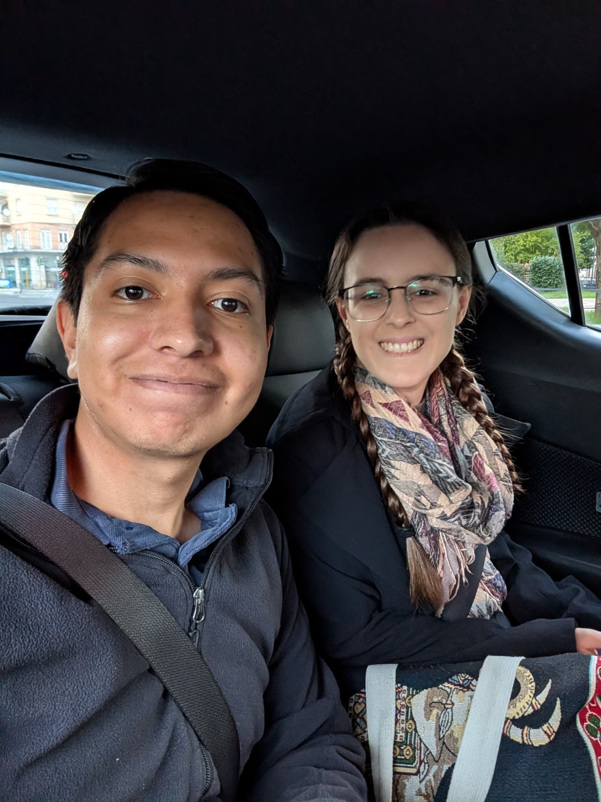
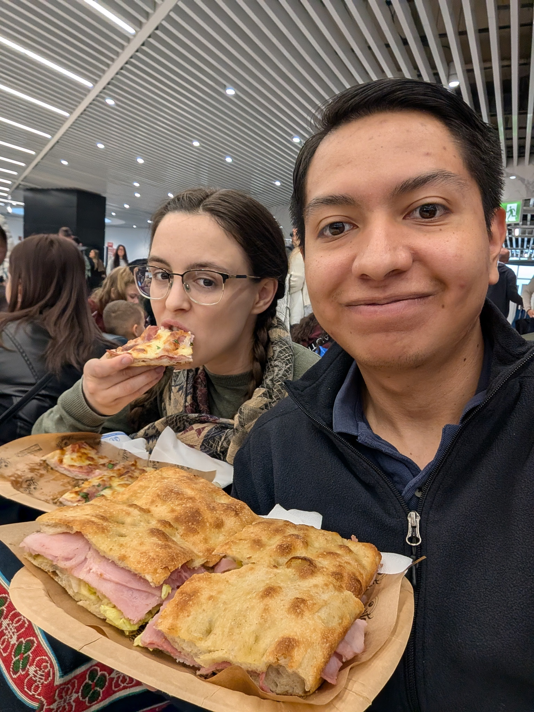
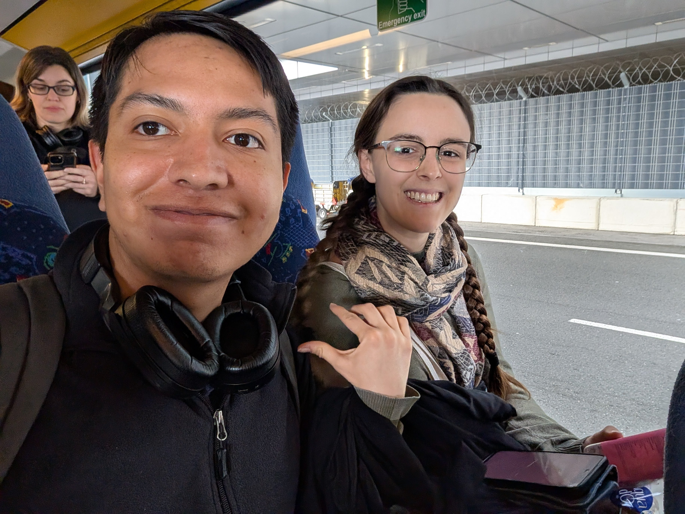
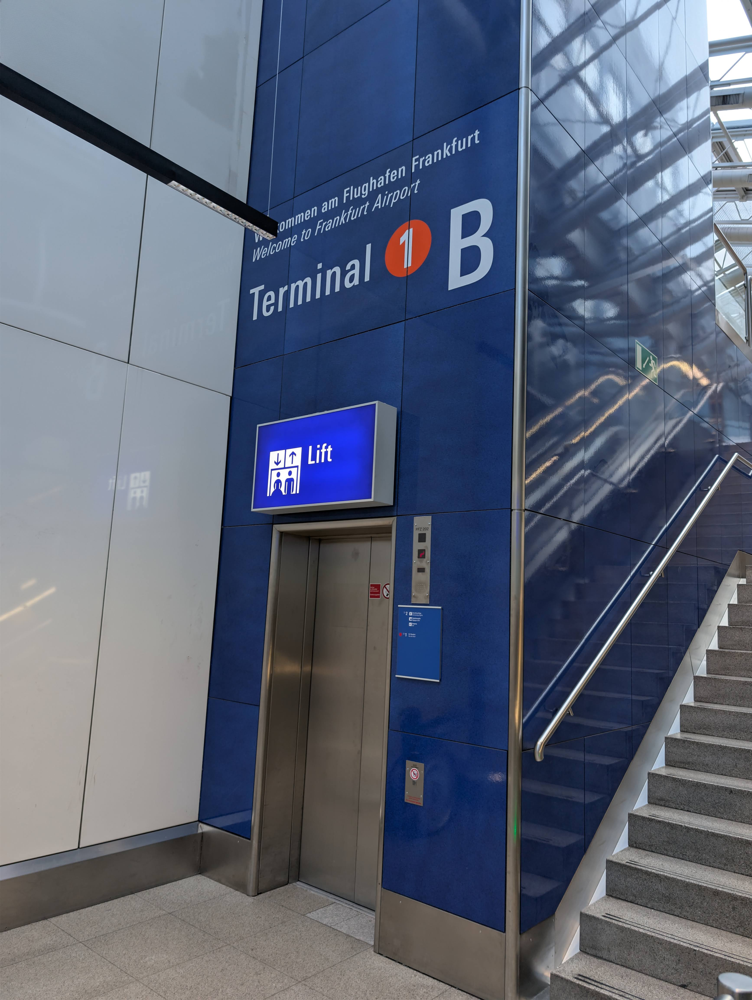
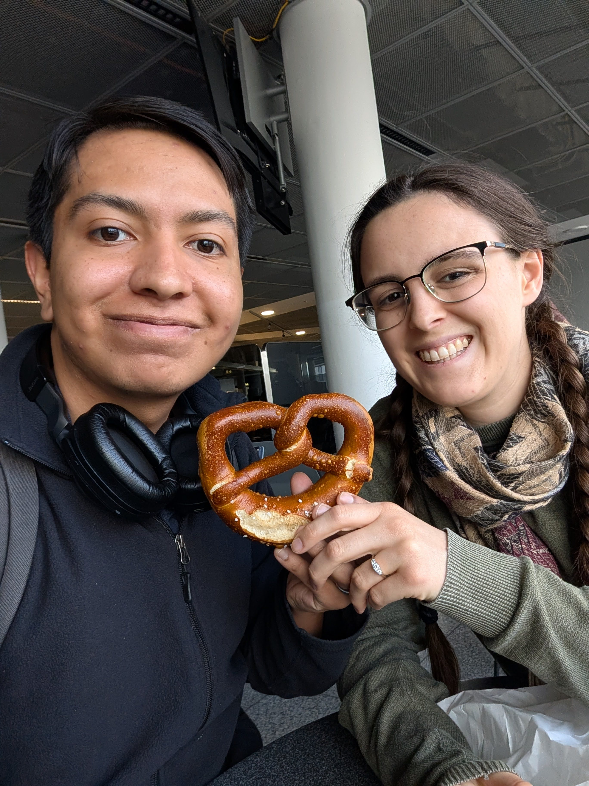
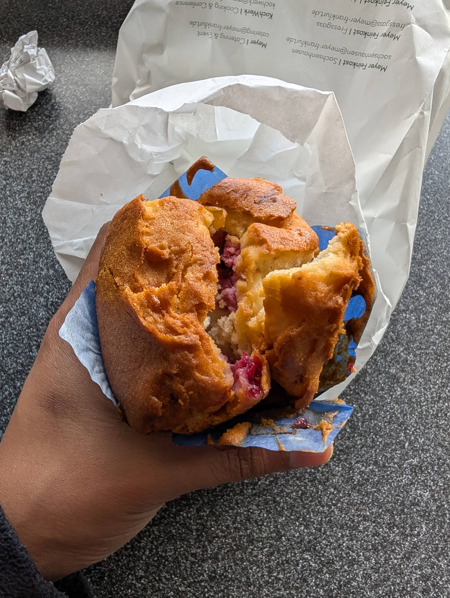
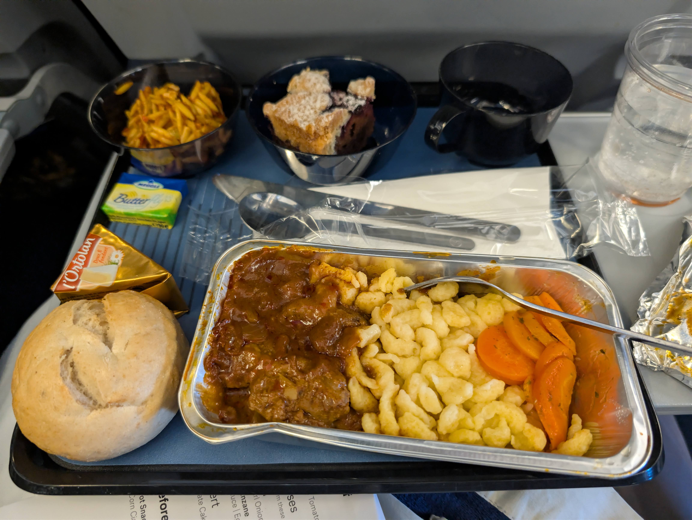

# Hora de despedirse

Como dirían los cantantes de ópera italianos: «Time toooooo say goodbyeeee»

::: carousel

:::

# Una escala en Fráncfort

Pero antes de llegar a casa hacemos una parada rápida en Fráncfort. Nuestro vuelo se retrasó, así que nos llevaron en un autobús especial directamente a nuestra puerta de embarque.

::: carousel

:::

# El vuelo a casa

::: carousel

:::
